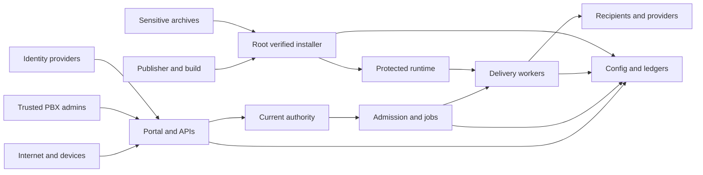

## Executive summary

This threat model retains source-review findings recorded before the withdrawn uppercase V0.1.9-beta release. The later v0.1.10-beta release was withdrawn for the version correction. The new candidate remains 0.1.9-beta, planned lowercase tag `v0.1.9-beta`, and is unpublished. [Qualification boundaries](QUALIFICATION_MATRIX.md) separate current K preparation, historical H/G/J evidence and the separately recorded user-reported target result.

The replacement preserves monotonically consumed MFA counters and their associated revision through separately retained recovery targets, without broadly excluding operator settings from comparison. Original snapshots and intention chains remain immutable; future intention ciphertexts and target publication are durable before restoration. Retries cannot lower the validated cursor, and authenticated terminal receipts preserve original/target/intention evidence against later pruning. Unrelated edits and unfinished immediate-settings journals remain conflicts. These changes address replay-state restoration risk without granting authority to accept missing phone history.

Withdrawn J passed 424 isolated suites and nine bounded native scenarios as 0.1.10-beta, following 207 focused recovery cases. Those exact results are historical; current K qualification/publication remain pending and published availability remains 0.1.8-beta. The user reports that 0.1.10-beta installed successfully, passed 16 doctor checks and preserved MFA/settings/keys after the administrator explicitly accepted 21 missing history records. This is user-reported, not independent target qualification of the new 0.1.9-beta artifacts. This dated threat model is not a new external audit, universal-layout result or deployment certification.

SLL turns public FreePBX, scoped operator/API and signed external inputs into notifications and optional physical effects. Principal risks are stale authority, duplicate effects, content exposure, shared-PBX availability and privileged maintenance. Confirmed source fixes and remaining limits are distinguished below; ten threat scenarios do not mean ten vulnerabilities. No account bypass or root code execution was demonstrated. Source and installed-generation qualification remain separate.

## Scope and assumptions

- In scope: first-party PHP module/portals/APIs; Python delivery, phone and Weather workers; secrets/state; callbacks/media; optional Labs; privileged installation and recovery. Vendor code is followed at relevant boundaries, not claimed exhaustively reviewed.
- **User confirmed:** one internet-facing PBX; trusted PBX administrators; restricted operator/API audiences; phones, desktops and providers cannot confer PBX/root authority.
- Messages, addresses, credentials, incident responses and floor plans are potentially sensitive. Actual content sensitivity and anonymous-media policy affect TM-005.
- Runtime is separate from build/sign/CI (`tools/build_tgz.sh`, `tools/sign_release.py`, `.github/workflows/`) and isolated fixtures (`tools/run_isolated_tests.sh`). No actual notification/provider actions are part of this audit.
- Open qualification: enabled Labs, media policy, device/provider acceptance, fleet load and recovery. These are deployment questions, not presumed defects. Pre-cURL DNS delay is measured separately; installed deployment remains unqualified.

Unless prefixed with `tools/`, `docs/`, or `.github/`, evidence paths below are relative to `slsmassnotifyserver/`.

## System model

### Primary components

- FreePBX administrator integration and separate MFA operator portal: `Slsmassnotifyserver.class.php`, `Operators.php::currentOperator`, `portal/index.php`.
- Control/Desktop APIs, dedicated callback/media routes and optional subscriber/display endpoints: `api/sls-mass-notify/index.php`, `api/sipnotify/index.php`, `portal/subscriber.php`, `portal/display.php`.
- Admission, queued preparation and irreversible channel delivery: `AnnouncementAdmission.php`, `AnnouncementDelivery.php`, `bin/sls_mass_notify/sls_notification_destinations.py`. `WeatherDeliveryReceipts.php` projects evidence without owning replay claims.
- Encrypted active/pending configuration plus private operational ledgers: `bin/sls_mass_notify/sls_config_crypto.php`, `EnterpriseIdentityStore.php`, `InitializationJournal.php`.
- Publisher-authenticated root installation, staged activation and recovery: `tools/install_release.sh`, `bin/sls_mass_notify/sls_release_trust.py`, `bin/sls_mass_notify/sls_privileged_install.py`. Runtime-writable PHP does not itself approve root execution.

### Data flows and trust boundaries

- **Browser → portal:** HTTPS password/TOTP/reset/WebAuthn and actions. Separate cookie, origin/CSRF, budgets, account version/expiry and local MFA constrain authority (`OperatorPortal.php`, `OperatorLoginRate.php`, `OperatorPasskeys.php`, `OperatorRecoveryService.php`). Federation requires local grants/MFA (`EnterpriseIdentity.php`).
- **Caller/device → APIs:** bounded HTTPS JSON, current scopes/audiences/enrollments and receipts. Proxy addresses/schemes require immediate-proxy trust; forwarded hosts confer no authority (`api/sls-mass-notify/security.php`, `api/sipnotify/index.php`).
- **Provider/automation → ingress:** bounded signed callbacks/fresh rule HMAC become evidence/actions, never PBX/root identity (`api/sls-mass-notify/sms-callback.php`, `trigger.php`, `AutomationInputs.php`).
- **Runtime → services:** HTTPS IdP/directory/delivery data. IdP vets/pins the whole destination set, verifies TLS/primary IP, forbids redirects/proxies and bounds transfers; other clients need individual contracts (`EnterpriseIdentityHttp.php`, `ScopedTls.php`).
- **Admission → delayed effects:** immutable recipients/principals cross queues/private files. Fresh authorization and durable acceptance/uncertainty must survive (`ApiPermissionGuards.php`, `DeliveryAuthorization.php`, `ControlIdempotency.php`).
- **PHP/runtime ↔ state/key maintenance:** checked files, locks, authenticated encryption and atomic replacement coordinate language/process boundaries (`bin/sls_mass_notify/sls_config_crypto.php`, `sls_config_crypto.py::_lock/maintain`, `EnterpriseIdentityStore.php::transaction`). Encryption cannot defeat a compromised Asterisk UID that legitimately reads the keyring.
- **Archive → root installation/recovery:** bounded bytes require authenticated publisher metadata, protected trust, archive/inventory validation and transactions. Preserve newer evidence/avoid replay (`tools/install_release.sh::prepare_authenticated_installer`, `bin/sls_mass_notify/sls_release_trust.py::authenticate_manifest`, `Restore.php`). Complete native backups include recovery keys: require independent archive encryption/access protection (`docs/RECOVERY.md`, `SECURITY.md`).

#### Diagram

## Assets and security objectives

| Asset | Why it matters | Security objective (C/I/A) |
|---|---|---|
| Root trust and executable bytes | Runtime input must not approve privileged code. | I, A |
| Audience, messages and effects | Forged/misrouted effects can cause operational harm. | C, I, A |
| Credentials, session bindings and keys | Protect human/device/provider impersonation and spending. | C, I |
| Replay, uncertainty and outcome history | Prevent duplicated effects and misleading evidence. | I, A |
| Incident/directory/private-media data | Contains personal, location and message information. | C, I |
| PBX workers, queues, storage and mail | Notifications share capacity with telephony. | A |
| Releases, backups and recovery snapshots | Authenticate installation and enable safe recovery; contain secrets. | C, I, A |

## Attacker model

### Capabilities

Internet attackers submit malformed requests, churn addresses, attempt authentication and induce transport failures. Stolen restricted credentials permit their own identity/audience and stale-job attempts. Providers/DNS/network adversaries supply hostile data/destinations/TLS. Archive thieves attack offline secrets. Remote attacks do not imply filesystem control. Maintenance additionally considers a compromised Asterisk UID substituting writable web ancestors, without root authority.

### Non-capabilities

The attacker lacks trusted PBX/root administrator authority, publisher keys and write access to protected root-owned trust paths. Approved scripts are trusted administrator code running with Asterisk authority. Compromised Asterisk/FreePBX can expose runtime-readable secrets and requires host incident response; at-rest encryption does not isolate that UID (`bin/sls_mass_notify/sls_privileged_install.py`, `bin/sls_mass_notify/sls_config_crypto.php::readKeyring`, `SECURITY.md`).

## Entry points and attack surfaces

| Surface | How reached | Trust boundary | Notes | Evidence (repo path / symbol) |
|---|---|---|---|---|
| FreePBX administration/Labs | Browser dispatcher | Trusted admin → module | Current admin, CSRF, revision and activation controls. | `Operators.php`, `EnterpriseAdministration.php` |
| Operator/reset/passkey portal | HTTPS | Internet → local principal | MFA, expiry/version, proof binding and budgets. | `portal/index.php`, `OperatorRecoveryService.php`, `OperatorPasskeys.php` |
| OIDC/SAML callback | Browser redirect/POST | IdP → local grant | One-use browser transaction; verified claims plus local MFA. | `portal/sso.php`, `EnterpriseIdentityOidc.php`, `EnterpriseIdentitySaml.php` |
| Control/automation ingress | JSON/credential/HMAC | Network principal → job | Bounded schema, scope/audience and current authority. | `api/sls-mass-notify/index.php`, `security.php`, `trigger.php` |
| Desktop/events/media | Device HTTPS | Enrollment/URL → content/evidence | Enrollment-bound events; anonymous generated-media compatibility default. | `api/sipnotify/index.php`, `api/sls-mass-notify/media-policy.php` |
| Callback/subscriber/display/push | Signed provider/person/device request | External evidence → local state | Current person/event binding; allowlisted push endpoints. | `sms-callback.php` under `api/sls-mass-notify/`, `SubscriberService.php`, `BrowserPush.php`, `portal/` |
| Phone/scheduled/Weather/Labs | Asterisk, fixed workers, enabled providers | Input/state → effect | Admission, expiry, capability and durable outcome checks. | `PhoneEventService.php`, `ScheduledDelivery.php`, `WeatherDeliveryReceipts.php`, `EnterpriseClusterProtocol.php` |
| Installation/recovery/build | Root CLI, archive, developer CI | Publisher/archive → privileged bytes | Signatures, trust/inventory and transactions; separate from runtime ingress. | `tools/install_release.sh`, `tools/sign_release.py`, `bin/sls_mass_notify/sls_upgrade_trust.py`, `Restore.php` |

## Top abuse paths

1. Restricted credential → admitted job → revoke/change authority during preparation → missing handoff check → stale audience effect (TM-001).
2. Forged/replayed callback or proof → identity/grant binding confusion → operator impersonation (TM-002).
3. Public request/source churn → consume bounded shared resources → notification/PBX degradation (TM-003).
4. Accepted-but-uncertain effect or stale restore → reset/retry claim → duplicate effect (TM-004).
5. Learn a media URL or combine restricted scopes → exceed intended projection → content/diagnostic disclosure (TM-005).
6. Hostile provider/DNS or failed first address → unsafe redirect/parse or stranded connection → credential loss/outage (TM-006).
7. Concurrent settings/key maintenance → inconsistent mutex → lost update/configuration outage (TM-007).
8. Hostile archive expansion or compromised runtime swapping web ancestors during root uninstall → exhaustion or protected recovery-key deletion (TM-008).
9. Compromised endpoint/person proof → foreign enrollment receipt/response → false evidence or disclosure (TM-009).
10. Enabled Labs input → stale disable/capability/authority → unapproved physical/public/cluster effect (TM-010).

## Threat model table

Ratings describe residual scenarios and review importance, not claims that every threat is exploitable.

| Threat ID | Threat source | Prerequisites | Threat action | Impact | Impacted assets | Existing controls (evidence) | Gaps | Recommended mitigations | Detection ideas | Likelihood | Impact severity | Priority |
|---|---|---|---|---|---|---|---|---|---|---|---|---|
| TM-001 | Scoped sender/delayed worker | Valid admission; later authority/config change. | Reuse stale authorization at later handoff. | Unwanted later submission or misleading completion; broader misrouting remains a threat scenario. | Audience/effect integrity. | `ApiPermissionGuards.php`, `DeliveryAuthorization.php`, immutable recipient contexts. | **Confirmed:** Weather/NWS/Lightning later effects/cancellation projection, child rendering/contact waits, voicemail mailbox lookup, SMS/email principal expiry or revocation and admission delays, MMS publication consuming deadlines or outlasting a committed STOP, and webhook cluster waits. Local PBX/approval lookups can outlast expiry; trigger bootstrap can outlast enrollment rotation. Reviewed handoff fixes are applied to candidate source; final build/install qualification is pending. No beyond-frozen-audience effect was demonstrated in these reproductions. | Recheck beside each handoff; refresh authoritative settings; preserve cancellation precedence; test revocation between channels. | Admission-to-handoff revision mismatches; denied/cancelled outcomes. | Medium: slow handoffs expose timing. | Medium reproduced; high conditional on dangerous deployment consequences. | medium |
| TM-002 | Internet/hostile IdP input | Callback/proof access; no local MFA. | Forge/replay identity or swap local grants. | Account impersonation. | Human authority. | `EnterpriseIdentityOidc.php`, `EnterpriseIdentitySaml.php`, explicit local grant/MFA in `EnterpriseIdentity.php`; version/proof/origin guards. | No bypass confirmed. Toolkit additionally counts all descendant assertions and binds direct signature/claims. | Preserve independent local MFA/grants and malformed/replay fixtures; track library changes. | Reason-coded private rejection audit. | Low: layered bindings and MFA. | High within SLL; root not implied. | medium |
| TM-003 | Remote source/device churn | Reachable portal/API. | Exhaust hashing, PHP, stream, queue or disk capacity. | Targeted shared-service outage. | PBX availability. | `OperatorLoginRate.php`, `OperatorPortal.php::passwordWork`, API admission/rate limits, `AnnouncementAdmission.php`. | **Observed:** 512 source failures over 512 synthetic seconds fill the 24-hour registry; new-source sign-in remains blocked even after credential reset, until a slot expires. Existing sources/admin remain usable. Fleet budgets need qualification. | Measure busy/denial rates; qualify load; retain fail-closed auth bounds and suitable edge controls. | 429, registry-full, worker/queue-age/storage metrics. | Medium: public churn is realistic. | Medium: targeted availability. | medium |
| TM-004 | Retrying caller/stale recovery | Accepted/uncertain effect or older history. | Reset/reuse claim and repeat submission. | Duplicate calls/provider/physical effects. | Replay and outcome integrity. | `ControlIdempotency.php::submit`, `EnterpriseIdentityStore.php` markers; `bin/sls_mass_notify/sls_notification_destinations.py::retry_external_deliveries/_recover_*_inflight`; `sls_phone_admission.py::PhoneAdmissionStore.admit_voicemail`; restore disable controls. | **Confirmed:** worker stores browser dedup identity after successful display; cache failure allows another show request (same tag can replace). Applied preclaim correction preserves explicit display-rejection retry. No exact-once human outcome. | Preserve uncertainty/newer history; no generic POST retry; qualify interrupted handoffs. | Uncertain claims, conflicting keys, missing markers. | Low with durable claims. | High for consequential duplication. | medium |
| TM-005 | URL holder/scoped reader | Anonymous media URL; or restricted read+monitor key. | Exceed intended content/detail projection. | Message/diagnostic disclosure. | Confidentiality. | `api/sls-mass-notify/media-policy.php` safety/optional auth; `SupportDiagnostics.php` independently protects acceptance notes. | **Intentional:** random media URLs lack recipient identity. **Confirmed low:** combined scopes expose readiness detail; source projection guard applied. No secret/acceptance leak shown. | Qualify explicit media policy; require unrestricted read for detailed readiness. | Download/capability refusals; scope-combination fixtures. | Medium link sharing; low scoped detail exposure. | Medium content-dependent; low reproduced diagnostics. | medium |
| TM-006 | Provider/DNS/network failure | Configured HTTPS integration. | SSRF/TLS confusion or dead chosen-address outage. | Secret loss or IdP/directory outage. | Credentials/network/availability. | Whole-set validation, exact private pins, TLS/primary-IP checks, no redirects in `EnterpriseIdentityHttp.php`; `ScopedTls.php`. | **Confirmed:** old IdP single-address limitation fixed in source; equivalent IPv4 CAP fallback is also applied to source. Native DNS waits exceed the cURL timer; separate availability limit. | Ship vetted-set native fallback; keep no POST replay and unsafe-member refusal; review other clients separately. | Connect/TLS/pin failures and endpoint changes. | Low SSRF; medium address failure. | Medium reproduced outage; high hypothetical exfiltration. | medium |
| TM-007 | Concurrent local processes | Settings mutation overlaps key maintenance/legacy lock. | Coordinate on unsafe/inconsistent mutex. | Lost update or settings outage. | Configuration integrity/availability. | Authenticated encryption/protected files; revised `_lock/maintain` in `bin/sls_mass_notify/sls_config_crypto.py` and PHP coordination. | **Peer-confirmed, patched:** owner/group/content/inode coordination; focused suites green. No root escalation shown. | Retain permanent shared lease and both acquisition-order/replacement tests; verify installed generation. | Lock/revision/authentication failures; preserve damaged evidence. | Medium: routine concurrency. | Medium: configuration availability/integrity. | medium |
| TM-008 | Candidate attacker/compromised runtime | Hostile download or administrator-supplied restore archive; or Asterisk UID plus concurrent root uninstall. | Expand before verification or substitute web-path ancestor before root deletion. | Exhaustion or protected recovery-key deletion. | Root trust/releases/recovery. | Authenticated manifests/protected entrypoints in `sls_release_trust.py`, `sls_privileged_install.py`; archive bounds/transactions. | **Confirmed:** 2,082-byte unsigned GPG input produced 2 MiB despite 64 KiB cap; output bound patched/six suites green. A tiny restored SQLite view also expanded an identity row beyond the source-file bound; restore now requires a plain stored identity table and bounded row projection. Uninstall web-parent swap deleted a protected synthetic sentinel; directory-descriptor containment source correction applied and nine focused suites passed. Final build/install qualification remains pending. No root code execution shown. | Bound pre-auth output; delete through validated directory descriptors; qualify both mirrored uninstallers and rollback. | Trust/expansion/inode rejects; missing retained key/snapshot evidence. | Medium expansion before fix; low conditional local race. | Medium exhaustion; high reproduced privileged deletion. | high |
| TM-009 | Compromised endpoint/proof | One valid device/person identity. | Reuse enrollment or claim foreign events/responses. | False incident evidence/disclosure. | Recipient identity/content. | Enrollment checks in `api/sipnotify/index.php`; hashed expiring proofs/current binding in `SubscriberService.php`; endpoint freezing/allowlisting in `BrowserPush.php`. | Own compromised endpoint can lie about its acknowledgment; no human-read guarantee. Some route semantics remain under review. | Keep identities independent of reused usernames; bind receipts to immutable event/current enrollment. | Foreign/expired event/proof and receipt-conflict rejects. | Low for cross-identity abuse. | Medium: evidence/privacy. | medium |
| TM-010 | Enabled Labs peer/provider | Trusted admin enabled controls/capabilities. | Act after disable or broaden external authority. | Unapproved optional effect. | Physical/public/cluster integrity. | `EnterpriseAdministration.php` admin/revision/master/child controls; `EnterpriseClusterProtocol.php` signed mTLS/replay authority; current delivery checks. | Default-off integrations require independent qualification; no bypass established here. | Keep disabled until qualified; revalidate current capability/authority at action; preserve uncertainty. | Disabled-feature attempts; stale witness/peer replay. | Low disabled; conditional medium enabled. | High for consequential actuation. | medium |

## Criticality calibration

- **Critical:** unauthenticated remote root execution; remotely bypassed publisher trust; broad consequential actuation despite disabled controls. None established here.
- **High:** SLL account/audience bypass; reusable credential theft across a real boundary; dangerous reproducible stale or duplicate effect.
- **Medium:** targeted shared-service exhaustion; configuration coordination loss; ordinary message-media exposure. Actual physical/content consequences can raise a confirmed case.
- **Low:** non-sensitive error detail; noisy bounded failure; inconsistency requiring an already trusted administrator with no new authority.

## Focus paths for security review

| Path | Why it matters | Related Threat IDs |
|---|---|---|
| `Operators.php` | Principal/MFA/audience. | TM-001, TM-002 |
| `OperatorPortal.php` | Session/CSRF/password budgets. | TM-002, TM-003 |
| `OperatorRecoveryService.php`, `OperatorPasskeys.php` | One-use repair/RP/origin binding. | TM-002 |
| `EnterpriseIdentityOidc.php`, `EnterpriseIdentitySaml.php` | Token/XML signatures and replay. | TM-002, TM-006 |
| `EnterpriseIdentityHttp.php` | Vetted HTTPS destinations. | TM-006 |
| `EnterpriseIdentityStore.php` | Durable bounded replay evidence. | TM-002, TM-004, TM-009 |
| `api/sls-mass-notify/index.php`, `security.php` | Parsing/scopes/proxy trust. | TM-001, TM-003 |
| `api/sipnotify/index.php` | Enrollment/event/stream isolation. | TM-003, TM-009 |
| `api/sls-mass-notify/media-policy.php` | Media confidentiality policy. | TM-005 |
| `DeliveryAuthorization.php`, `AnnouncementDelivery.php` | Fresh handoff authority. | TM-001, TM-004 |
| `ControlIdempotency.php`, `bin/sls_mass_notify/sls_notification_destinations.py` | Durable claims/retry uncertainty. | TM-001, TM-004 |
| `EnterpriseApprovalService.php` | Exact two-person review and current deadline. | TM-001 |
| `bin/sls_mass_notify/sls_phone_admission.py` | Permanent voicemail claims. | TM-001, TM-004 |
| `bin/sls_mass_notify/sls_config_crypto.py` | Cross-language key/configuration mutex. | TM-007 |
| `SubscriberService.php`, `BrowserPush.php` | Recipient-bound proofs/endpoints. | TM-006, TM-009 |
| `EnterpriseAdministration.php`, `EnterpriseClusterProtocol.php` | Feature/external authority boundaries. | TM-010 |
| `bin/sls_mass_notify/sls_privileged_install.py`, `sls_release_trust.py`, `sls_upgrade_trust.py` | Publisher-to-root trust/expansion. | TM-008 |
| `tools/install_release.sh`, `tools/uninstall_release.sh` | Transactional verified teardown/activation. | TM-007, TM-008 |
| `Restore.php`, `bin/sls_mass_notify/sls_operational_backup.py` | Sensitive recovery/newer-history preservation. | TM-004, TM-008 |

## Notes on use

Source review and reviewed corrections were recorded 2026-10-28. User confirmed context and peer review calibrated the findings. The [security audit](SECURITY_AUDIT_0.1.9.md) records stable qualification and remaining limits. A separately retained owner verification record remains outside the package so build/install results can be recorded after source freeze without changing packaged bytes. Multi-address pinning needs [libcurl 7.59+](https://curl.se/libcurl/c/CURLOPT_RESOLVE.html); the [connection timeout](https://curl.se/libcurl/c/CURLOPT_CONNECTTIMEOUT_MS.html) excludes earlier resolver calls. No zero-vulnerability, external-penetration, life-safety, full-PBX-recovery or target-fleet certification is claimed.
